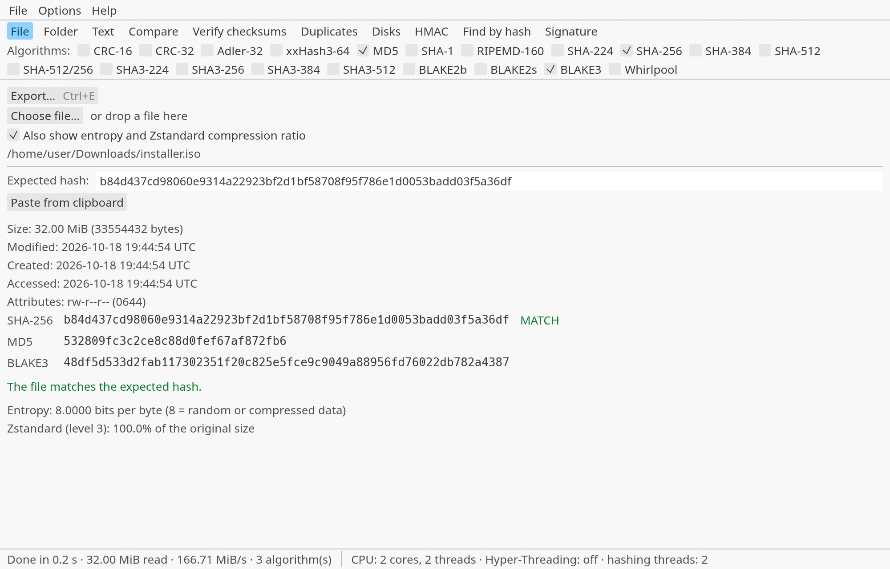
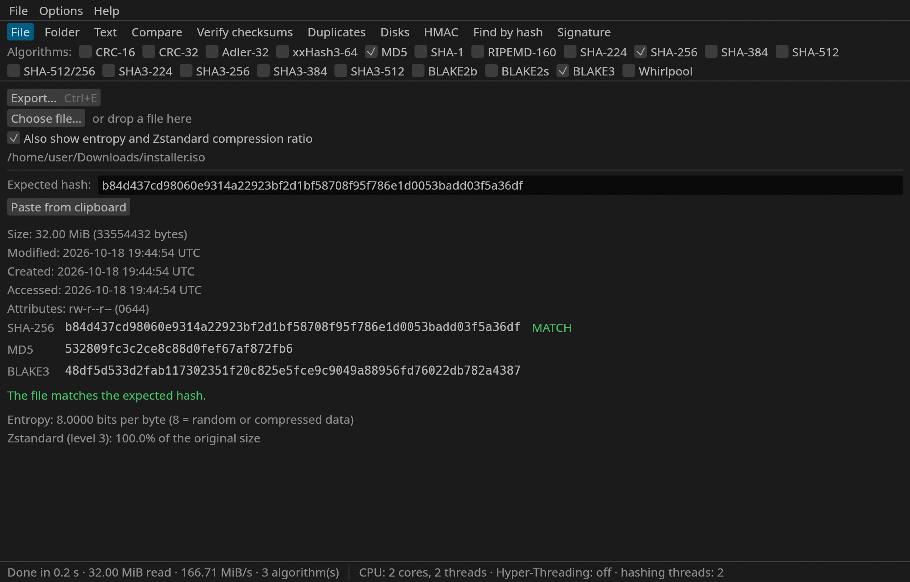

# Hash Manager — Calculate and Verify Hashes on Windows, Linux and macOS

[](https://github.com/Hanatarou/HashManager/releases/latest)
[](https://github.com/Hanatarou/HashManager/actions)
[](https://github.com/Hanatarou/HashManager/releases)
[](https://github.com/Hanatarou/HashManager/releases/latest)
[](LICENSE)


## 🤖 A Note on AI Usage

I built this project alone, as a personal project, with substantial help from AI tools — mainly Claude. I believe knowledge only survives past us if it's shared, and that's the spirit behind releasing this for free.

I did this on my own time and dime, covering all costs myself, without asking anyone for donations.

Just as I respect opinions against the use of AI, I expect the use of AI here — as a tool that helped me build this project — to be respected in return. Disrespect toward this work, toward me, or toward anyone else involved will not be tolerated.

All AI-generated content is reviewed and validated by me before being committed — I stand behind every decision to include code in this repository, regardless of how it was originally written. This project is still provided as-is, under the MIT license below, with no warranty of any kind.

If you're uncomfortable with AI-assisted code for any reason, you are under no obligation to use, contribute to, or engage with this project. No hard feelings — just move on.

For everyone else: bug reports and PRs are evaluated on their merits (does it work, is it correct), not on how the code was produced.

> A notice about AI is also shown inside the program, in **Help > About**.

## 🙏 Inspired by QuickHash and CHK Hash Tool

Hash Manager exists because of **[QuickHash GUI](https://github.com/tedsmith/quickhash)** by Ted Smith and the **[CHK Hash Tool](https://compressme.net/)**. They defined the jobs a hash tool is expected to do: hash a file, a folder or a text, compare two files or two folders, find duplicates, look at the entropy of a file. Many thanks to everyone who built and maintains them. If one of them does what you need, both are mature tools and a great choice.

Hash Manager is an **independent re-implementation in Rust**, with a different goal: be simple, fast, and the same program on Windows, Linux and macOS. No source code from QuickHash or CHK was copied; the ideas were learned from them and are credited here and in **Help > About**.

## 🎯 What is Hash Manager?

A small native program (a window) that calculates and verifies hashes:

- **File:** choose or drop a file; paste the hash you expect and see at once whether it matches. The usual ways to copy a hash are read: hexadecimal in any case, in groups or as `AA:BB:...` bytes, with `0x`, Base64, in quotes, with a label that names the algorithm (`sha256:...`, `SHA-256: ...`, the `sha384-...` of a web page's `integrity`) and a whole line of a checksum file (`hash  file`, `SHA256 (file) = hash`); a label that names the algorithm also tells which one to compare with. If the pasted hash does not fit a ticked algorithm, the program tells you which one to tick (by its length). Shows the file's dates and attributes and, on Windows, its NTFS alternate data streams.
- **Folder:** hash every file (with or without subfolders), filter the list, save a checksum file. Drop several files and folders at once: one job, one table.
- **Text:** the whole text, line by line, or Base64 (the decoded bytes are hashed). Updates as you type.
- **Compare:** two files or two folders (same, different, only in A, only in B). Files or folders that cannot be read are listed and left out, so they are never reported as missing. Names are matched as the file system of the system you run on does: Linux tells every difference, Windows ignores upper and lower case, macOS also ignores how an accented letter is written (`é` as one character or as `e` and an accent). A name that is the same in both folders always matches itself first, so two names that differ only in case in one folder (possible in a folder that tells them apart) are never mixed up.
- **Verify checksums:** reads `.sha256`, `.md5`, `.sfv` and `SHA256SUMS` files (GNU and BSD formats) and tells which files are OK, changed or missing.
- **Duplicates:** finds identical files; deleting is optional. Folders and files that could not be read are listed, because a copy in them would be missing from the groups.
- **Disks:** lists each disk (model, size, type, volumes) and hashes a whole disk, read-only. Also hashes **disk image files**: raw (`.dd .img .raw .iso`), split raw (`.001 .002…`), VHD (fixed and dynamic) and EnCase **E01** (the hashes stored in the image are compared with the ones just computed).
- **HMAC:** a hash with a secret key, for any cryptographic algorithm; text (live) or a file.
- **Find by hash:** which files of a folder have this hash (hexadecimal or Base64; the algorithm is guessed from the length, all candidates are checked in one read). Whatever could not be read is listed, so "no match" never hides a part of the folder that was not searched.
- **Signature:** checks **minisign** (`.minisig`) and **OpenPGP** (`.asc`, `.sig`) signatures with the publisher's public key.
- **Export** of the results of any tab as JSON (for other programs), HTML (for people; it also works as a verification report) or DFXML (the interchange format of digital forensics).
- **Entropy and Zstandard ratio** of a file.

Algorithms (20): CRC-16, CRC-32, Adler-32, xxHash3-64, MD5, SHA-1, RIPEMD-160, SHA-224, SHA-256, SHA-384, SHA-512, SHA-512/256, SHA3-224, SHA3-256, SHA3-384, SHA3-512, BLAKE2b, BLAKE2s, BLAKE3 and Whirlpool. Hashes can be shown as hexadecimal or Base64.

- ✅ One executable, no installer, no runtime to install
- ✅ 20 languages (22 with the regional variants of Spanish and Portuguese), chosen in **File > Language**; the decimal separator (system, point or comma) in **File > Decimal separator**
- ✅ Fully portable: no installer, no registry, no Explorer menu, no shortcuts; everything it writes lives next to the program
- ✅ Needs no administrator rights (only reading a whole disk does)

## 🖼️ Screenshots

The File tab in English, in the light and in the dark theme (the program follows the theme of the system, and **Options** lets you choose). They show what the program computes for a real 32 MiB file: three hashes, the match with the expected one, the file information, the entropy and the Zstandard ratio.

| Light theme | Dark theme |
|:---:|:---:|
|  |  |

## ⭐ Where it tries to be better

Every item below is something the program does; the hashing, checksum-file, comparison, duplicate and settings code has unit tests. These are design choices, not a claim that this tool is better for everyone.

### Speed
- ⚡ **One read, many hashes:** each file is read once, however many algorithms are ticked, and every algorithm runs on its own thread while the next block is being read.
- 🧵 **Threads you can see and limit:** the status bar shows the cores, the threads and whether Hyper-Threading is on. *Options > Use Hyper-Threading threads* limits the hashing threads to one per physical core. (Hyper-Threading itself is a BIOS/UEFI setting; no program can switch it.)
- 🚀 SHA-NI / AVX2 are used automatically when the processor has them.
- 🗂️ **Several files at once:** Folder, Verify and Duplicates hash several files in parallel (*Options > Calculate several files at the same time*; turn it off for a hard disk, where reading two files at once is slower). The hashing threads come from one shared budget (the limit above): many small files run side by side whatever the number of algorithms, and a big file with many algorithms takes the whole budget while it runs, so the threads never exceed the limit.
- 📈 The status bar shows progress, speed, elapsed time and time left, and after a run the average speed.

### Safety
- 🔒 **Nothing is written** by hashing, comparing or verifying. Disks are opened for reading only.
- 🧱 **Duplicates:** nothing is marked at the start, deleting asks for confirmation, the program refuses to delete every copy of a file, and just before deleting it looks at the disk again: a file that is no longer as it was found (different size or different modification time), or a group with no copy left, is not touched. Each file to be deleted is also read again and deleted only if it still has the content of the group, and at least one copy that stays must still have it too; deleting runs in the background, shows progress and can be cancelled.
- 🧭 **Verify** never guesses silently: a line whose hash length matches no algorithm, or that no format reads at all (a hash with a digit missing, a line with something else), is reported as SKIPPED and counts as a failure (it is never left out of the count), a file that is not there as MISSING, a file that is there but cannot be read as UNREADABLE ("Cannot verify" in the window). When a hash fits several algorithms (SHA-256, SHA3-256 and BLAKE3 are all 64 digits) every one of them is checked in the same read, and the result names the one that matched, or all that were tried; a file written by this program is therefore always verified, whatever algorithm made it. The same holds in File (an unticked algorithm of the same length is offered before saying "different") and in BSD lines. A list with no line at all (empty, or only comments) is the one that has nothing to check: "No checksum lines found."; a list whose lines are all unreadable is checked line by line, each one SKIPPED (the note says "line not understood" for a line no format reads, and that the length is unknown for a hash no algorithm has).
- 🔗 Symbolic links are skipped, so a link cannot lead the program out of the folder or into a loop; hard links to the same data are not reported as duplicates.
- 🧩 A damaged settings file falls back to the defaults, and the program says so.
- 💾 **Settings are written in two steps** (a temporary file, then a rename), so a power cut never leaves a half-written `.ini`.
- 🧷 Saving over a file that already exists keeps what the old one had: its permissions and, on Linux and macOS, its owner and group (a file of another user that root saves stays that user's); on Windows the file is replaced with `ReplaceFileW`, which keeps its access list (ACL), attributes, creation time and alternate streams. If that call cannot be made the file is replaced by a rename, as before.
- 🚫 A name that is a device and not a file (`CON`, `NUL`, `COM1`, a named pipe on Windows; a pipe, a socket or a terminal elsewhere) is refused instead of being read: reading a console never ends, and `NUL` would be an empty file that is not there.
- 🔗 The program refuses to write its log or settings through a **link or junction** (a link in place of the `log` folder cannot send logs, or the deletion of old ones, somewhere else).
- ⚠️ If the folder cannot be written to (a **read-only pen drive** or disc), the program says so at startup instead of silently losing settings and logs.
- 📝 The log records, for each action, what was done, on what, how long it took and, for errors, the kind of error and the operating system error code.

### Practical
- 🎯 **The right number of algorithms per tab:** several in File, Folder, Text and Compare (files); exactly one in Disks and Compare (folders); none in Verify (it comes from the file) and Duplicates.
- 📋 Click any hash to copy it. Hashes can be shown in UPPERCASE.
- 🖱️ Drag and drop on every tab; `HashManager <path>` opens the program already hashing a file or folder ("Open with").
- 💽 **Disks** are listed with their model, size, type (SSD, hard disk, NVMe, USB...), removable or not, and their volumes, so you know which one to pick.
- 📤 Export as JSON, HTML or DFXML, and checksum files (`hash *path`, paths with `/` so the file works on every system; names are written relative to the folder where the list is saved, `../other/file` when the file is outside it, so the list verifies from where it is).
- 🌍 **20 languages** (22 with the regional variants), detected from the system language on the first run. Arabic and Urdu are shown right to left (text only; the window layout is not mirrored).
- 💾 Remembers your options, language, decimal separator, theme and **window size and position** (`HashManager.ini`); keeps the 30 most recent logs.
- 🪟 **Window:** opens where you left it when that still fits on the monitor (even a monitor that was unplugged or a changed resolution); otherwise, and on the first run, at 60% of the work area, centered (the same rule as DriverStore Manager). On Linux and macOS the monitor is only known once the window is open, so the window is corrected right after it appears.
- 🖱️ **Right-click on a result:** copy the cell, copy the row (tab separated, with the column titles), copy the path, open the folder. A path cut off by the column width shows in full when you hover it.
- 🧱 **Defensive reading** of `HashManager.ini`: comments (`;`), `[sections]`, spaces and a BOM are accepted, and only the first 16 KiB are read.
- ⏸️ **Pause and resume** a long job (the paused time is not counted in the speed).
- ⌨️ Keyboard shortcuts (see below), light / dark / system theme, keep-on-top option.

## 🔍 What it does *not* do

- ❌ Disk images: VHDX, VMDK, QCOW2, VDI, differencing VHD and EnCase logical evidence (L01) are recognised but not decoded (the container file is hashed, or the program says it cannot).
- ❌ No automatic updates. The program never asks for administrator rights, so reading a whole disk needs it to be started with them; without them it fails with a message.
- ❌ A valid signature only proves the file matches that key; the program cannot tell you whether the key belongs to the publisher. Get it from their website or compare its fingerprint another way.
- ❌ It is not forensic software: no write blocker, no chain-of-custody report.
- ❌ On macOS the disk list shows only whole disks, not partitions or volumes.

## 📦 Installation

There is no installer. Download the zip of your system from the [releases](https://github.com/Hanatarou/HashManager/releases/latest), extract it and run `HashManager`. The zip holds only the executable. Each zip comes with a `.sha256.txt` with the SHA-256 of the executable, so you can verify it after extracting, with this program if you like.

| Item | Location |
|---|---|
| Log, one file per run (the 30 newest are kept) | `.\log\HashManager_<start time>.log` |
| Settings | `.\HashManager.ini` |

The program is portable: both are kept next to it and nothing is written anywhere else. **File > Open log folder** opens the logs.

### Requirements
- Windows 10 or later, 64-bit (the C runtime is linked statically: nothing to install); Linux x86-64 with OpenGL and X11 or Wayland, plus `xdg-desktop-portal` (with a GTK or KDE backend) for the file dialogs; macOS 11 or later (Apple silicon or Intel)
- **macOS:** the program is not signed, so Gatekeeper blocks the first launch. Right-click the file > Open, or run `xattr -d com.apple.quarantine HashManager`.
- Administrator (Windows) or root (Linux, macOS) only to hash a whole disk

## 🚀 Usage

### Menus
- **File:** Open file, Open folder, Export, Run again, Clear this tab, Open log folder, Language, Exit.
- **Numbers on the screen** (sizes, entropy, seconds) use the decimal separator chosen in **File > Decimal separator** (`6,00 MiB` or `6.00 MiB`; by default the one of the system), whatever the language of the program; JSON, DFXML, HTML exports and the log always use the point.
- **Options:** UPPERCASE, include subfolders, entropy and Zstandard ratio, use Hyper-Threading threads, hash several files at once, show hashes as hexadecimal or Base64, theme (system / light / dark), keep window on top, show file dates and attributes, hash alternate data streams (Windows).
- **Language:** the 22 languages, in alphabetical order (`Language (Country)`, each in its own language). **Decimal separator:** follow the system (default), point (1.5) or comma (1,5).
- **Help:** How it works, About.

### Tabs
| Tab | What you do | Algorithms |
|---|---|---|
| File | Choose or drop a file; paste an expected hash | several |
| Folder | Choose or drop a folder; filter; save checksum file | several |
| Text | Type or paste; whole, line by line or Base64 | several |
| Compare | Two files, or two folders | several (files), one (folders) |
| Verify checksums | Choose or drop a `.sha256`, `.md5`, `.sfv`... file | from the file |
| Duplicates | Choose a folder; mark and delete extra copies | BLAKE3 |
| Disks | Pick a disk from the list and hash it, or hash a disk image file | one |
| HMAC | Key (text or hexadecimal) and a text or a file | one (cryptographic) |
| Find by hash | Choose a folder, paste a hash | guessed from the length |
| Signature | File, signature, public key (drop all three together) | of the key |

### Keyboard shortcuts

| Keys | Action |
|---|---|
| F5 | Run the last action of this tab again |
| Ctrl+O | Choose what this tab works on |
| Ctrl+E | Export the results (format by file extension: `.json`, `.html`, `.xml`) |
| Ctrl+F | Folder tab: go to the filter; any other tab: go to Find by hash |
| Ctrl+N | Clear this tab |
| Ctrl+P | Pause / resume the running job |
| Esc | Cancel the running job |
| Ctrl+1 … Ctrl+9, Ctrl+0 | Go to the 1st … 10th tab (Cmd on macOS) |

## 📐 File format rules

- **Names that are not text.** On Linux a file name is any sequence of bytes except `/` and NUL, on Windows UTF-16 that may hold a lone surrogate, and XML 1.0 cannot hold some characters at all. No file is ever left out of a report or a list, on any system. A name that is valid UTF-8 and has only characters XML can hold is written as it is. Any other name is written twice: `path` (readable; each byte or character that cannot be written is U+FFFD) and `path_percent` (JSON; `<hm:filename_percent>` in DFXML; under the name in HTML), the exact name percent-encoded: letters, digits and `-._~/` as they are, every other byte as `%XX` (`bad\xff.txt` is `bad%FF.txt`). On Windows the bytes are WTF-8 (UTF-8 in which a lone surrogate takes three bytes, `%ED%A0%80`). The report says which: JSON has `"platform": {"os", "arch", "name_encoding": "bytes"|"wtf-8"}`, DFXML has `hm:name_encoding` on `<execution_environment>` (with `<os_sysname>` and `<arch>`), HTML has them in the footer; the name or version of the system is not written.
- **Checksum files** (written and read): one line per file, `hash *path` (GNU binary mode), paths with `/` and relative to the checksum file; a path written with `\` is also found on Linux and macOS (only the separator is read differently, and only when the name as written is not there: a name is never trimmed or changed otherwise, so the file the list means is the file that is checked). Only a space and a tab are syntax in a line (a no-break space is part of a name); a byte order mark is ignored at the start of the list only. A list saved as UTF-16 (what the PowerShell of Windows 10 writes with `>` and `Out-File`; with or without a byte order mark, little or big endian) is read as well. A name with a backslash, a line feed or a carriage return (Linux, macOS) is written as `sha256sum` does: the line starts with `\` and the name has `\\`, `\n` and `\r` (a list with CRLF line ends, made on Windows, is read as well; a carriage return in a name of a list that does not escape it cannot be told from the end of a line); on Windows `\` is a folder separator and becomes `/`. The names are written as the bytes they are (as `sha256sum` does), so a name that is not UTF-8 is in the list and verifies from it. CRC-32 is written as `path CRC` when the list is called `.sfv` or `.crc32` (the name decides how a list is read, so it decides how it is written); in a list with any other name it is a sum like the others (`crc *path`), which Verify reads back whatever the name. An SFV has no way to write a line break in a name, a `;` or `#` at its start, or spaces at its start or end, so such a file is listed as not hashed (see below). **A file that could not be hashed** is in the list as a comment line, `# NOT HASHED: name: reason` (`;` in an `.sfv`; a `: ` inside the reason is written ` - `, so the last `: ` of the line separates the name from the reason): other tools ignore it (`sha256sum -c` says OK for the files that are listed and does not mention it), and only Verify shows it as SKIPPED and count it as a failure. Read: GNU (`hash  file`, `hash *file`; a text-mode name may be only spaces), BSD (`SHA256 (file) = hash`, and the OpenSSL form `SHA256(file)= hash`; `sha256sum --tag` writes `\SHA256 (name) = hash` with the same escapes for a name that needs them) and SFV; `;` and `#` lines are comments. **SFV or GNU:** `name CRC` and `hash  name` can look the same (`<32 digits> 1A2B3C4D` is a file with a hash for a name in an SFV, and a file called `1A2B3C4D` in a list of sums). The name of the list settles it: a `.sfv` file is read as SFV, a file named for another algorithm (`.sha256`, `SHA256SUMS`...) as GNU (`FILE.crc32`, written for CRC-32 among several algorithms, is an SFV too). With no such name (`list.txt`) the shape does: a GNU line always has the mode character after the hash (a space or `*`), so `hash  20240101` is a sum, and `<hash> <8 digits>` with one space is an SFV; the one case left that only the name of the list can settle is an SFV line, in a list not called `.sfv`, of a file whose name starts with a hash and a space. An SFV has no way to write a name with a line break, a `;` or `#` at the start, or spaces at the start or the end: such a name is listed as not hashed (and Verify counts it as SKIPPED).
- **JSON** (for other programs): UTF-8. `{"schema": 1, "generator", "generated", "report", "title", "summary", ...}` and then **either** `"complete": true|false` and `"files": [{"path", "status", "size", "hashes": {"sha256": "…"}}]` (a result that is hashes of files: File, Folder, Duplicates and Find; `size` is left out when it is not known; `status` is `ok`, or `error` with an `error` text and no hashes for something that could not be read, and then `complete` is `false`) **or** `"columns": [keys]` and `"rows": [{key: value}]` (every other result). The keys and the words that stand for a result (`same`, `different`, `only_a`, `only_b`, `unreadable_a`, `unreadable_b` (in a folder comparison: could not be read on that side, so not compared), `ok`, `mismatch`, `missing`, `skipped`, `valid`, `invalid`, `unreadable`) are the same in every language and version of the interface; the algorithm keys are `crc16 crc32 adler32 xxh3 md5 sha1 ripemd160 sha224 sha256 sha384 sha512 sha512-256 sha3-224 sha3-256 sha3-384 sha3-512 blake2b blake2s blake3 whirlpool`. Sizes are numbers (bytes). Hashes are always lower-case hexadecimal **strings** (so a CRC such as `00123456` keeps its zeros), whatever the display option; the screen still shows the encoding chosen. `generated` is ISO 8601 in UTC, `2026-10-16T18:41:25Z`. A change that breaks a reader raises `schema`. Modification dates are not exported.
- **HTML** (for people): one self-contained page (inline style, no script, no external resource), every text escaped, light and dark colours, the table as it is on the screen (a name that is not text with its exact form under it, also on the File tab; what could not be read in a table of its own, with a line above the first table), a footer with the program, its version and the date in UTC.
- **DFXML** (Digital Forensics XML 1.0, `.xml` or `.dfxml`): only for results that are hashes of files (File, Folder, Duplicates, Find); any other result says it cannot be written in it. `<dfxml xmlns="http://www.forensicswiki.org/wiki/Category:Digital_Forensics_XML" version="1.0">` with `<metadata>` (`dc:type` Hash List, `dc:date`), `<creator>` (program, version) and one `<fileobject>` per file: `<filename>` (the whole path as given), `<filesize>` when known, and the hashes. DFXML names `md5 sha1 sha224 sha256 sha384 sha512`, written as `<hashdigest type="sha256">…</hashdigest>`; the other algorithms (CRC, Adler-32, xxHash3, RIPEMD-160, SHA-512/256, SHA-3, BLAKE, Whirlpool) are written as `<hm:hash algorithm="sha3-256">…</hm:hash>` in the namespace `urn:hash-manager:dfxml-extension:1`, after the DFXML elements, which the schema allows and other tools ignore. XML 1.0 cannot hold controls other than tab, line feed and carriage return, nor U+FFFE and U+FFFF: such a character in a name is written as U+FFFD in `<filename>` and the exact name is in `<hm:filename_percent>`. A result of part of the rows (see Export) has `<hm:partial filter rows_total rows_exported/>` after the files. Something that could not be read is a `<fileobject>` with `<filename>`, `<hm:status>error</hm:status>` and `<hm:error>` (no hashes), and `<hm:incomplete failed="N"/>` closes the document.
- **Hashes:** hexadecimal in lower case by default (UPPERCASE in Options), or standard Base64 with padding. A pasted hash may be hexadecimal, or Base64 with or without padding (standard or URL-safe) when its length is a digest length.
- **Sizes** are shown in binary units (KiB, MiB, GiB, TiB) everywhere, including the disk list.
- **Export:** `Ctrl+E` / Export exports everything the tab holds. When a filter (Folder) or *hide the same* (Compare folders) hides rows, a second button, *Export only what is shown (N of M)*, exports only those, and the report says so itself (JSON `"partial": {"filter", "rows_total", "rows_exported"}`, HTML a line above the table, DFXML `hm:partial`). A folder or a duplicates search in which every file failed to be read can be exported too (the report holds the failures). The report of Find is of the hash that was searched. The format is the extension of the name given (`.json .html .xml .dfxml`; another extension gets `.json` added).
- **Dates** are shown in UTC as `yyyy-MM-dd HH:mm:ss UTC`; the log uses the local clock as `yyyy-MM-dd HH:mm:ss`; what is written for other programs (JSON, DFXML) is ISO 8601 in UTC, `yyyy-MM-ddTHH:mm:ssZ`.
- **Settings** (`HashManager.ini`): `key=value`, one per line, unknown lines ignored; written in two steps.
- **Same length, which algorithm?** When a pasted hash fits several algorithms, they are tried in this order: SHA-256, SHA3-256, BLAKE3, SHA-512/256, BLAKE2s (64 digits); SHA-512, SHA3-512, BLAKE2b, Whirlpool (128); SHA-1, RIPEMD-160 (40); and the first is the answer when only one is ticked. Every candidate is always checked in the same read, so a match with any of them is found.

## 🧪 First run, with care

1. Download the zip, extract it, and check the executable against the `.sha256.txt` (with this program, *Verify checksums*, with both files in the same folder).
2. Run it from a folder you can write to; it creates `HashManager.ini` and `log\` next to itself and nowhere else. On a read-only drive it warns you and still works.
3. Try it on a small file first (File tab, a text file): the hash of an empty or one-line file is easy to check against another tool.
4. Nothing is deleted or modified by hashing. The only thing that deletes is *Duplicates > Delete*, which asks first, checks the content again and never removes the last copy.
5. Disks are only read. If you did not start the program as administrator/root, hashing a disk fails with a message; the program never asks to be elevated.

## 🔧 How it works

- **Reading:** a 1 MiB block at a time. The block is shared with one thread per algorithm (fewer if limited), so several hashes cost about as much as the slowest one. Progress, cancelling and the speed come from the number of bytes read.
- **Checksum files:** GNU (`hash  file`, `hash *file`), BSD (`SHA256 (file) = hash`) and SFV. When the algorithm is not written, it is taken from the name of the checksum file (`.b3`, `B3SUMS`, `.sha3`, `SHA512SUMS`...) and only then guessed from the length of the hash (see *File format rules* for the order). Lists of algorithms this program does not have (`b2sum -l 256`, `cksum -a sm3`...) are not supported: a hash of such a list is checked with the algorithms of its length and reported as different (the line says which were tried), never as OK. A file written by *Save checksum file* replaces the old one in one step; a destination that is not a regular file (a device, a pipe) is written to and not replaced, and a read-only file is left as it is (an error).
- **Disk images:** a raw image is read as is; split images follow `.001`, `.002`...; a fixed VHD is its declared size (a file shorter than that is cut short), a dynamic VHD is rebuilt from its block table (unallocated blocks read as zeros; the footer and header checksums are verified, the table must cover the whole disk and every block must lie inside the file, otherwise it is an error); a numbered file is a split image only with its `.001` next to it, and a gap anywhere in the numbering is an error; EWF is read segment by segment (`E01`, `E02`... `E99`, `EAA`...; the number inside each segment must match its position, the last one must end with `done`, and opening a later segment is refused), each chunk inflated (never beyond one chunk) or copied, and each must hold exactly the bytes the volume describes, and the MD5/SHA-1 stored by the acquisition tool are compared with the new hash. An image that ends before its declared size (a missing or damaged segment) is an error, never a hash of half the image.
- **Signatures:** minisign is checked with Ed25519 (including the BLAKE2b pre-hashed form and the signed trusted comment: a missing or damaged signature of the comment makes the result invalid); OpenPGP detached signatures are checked against the primary key and its signing subkeys (only the keys the signature names are read against the file). Nothing in the certificate is believed before it verifies under the primary key: the self-signatures (flags, expiry), the revocations, and each subkey's binding with its back-signature; a subkey that was only appended to the certificate does not count. Only a signature over data counts (not a certification), it must carry a creation time, and one made more than a few minutes in the future or before the key existed is INVALID. The expiry that counts is the newest one stated by the key's own signatures (a later signature without an expiry removes it; a secondary identity cannot), a subkey expires at the earlier of its own date and the certificate's, a primary key whose flags forbid signing does not sign, and a subkey can be revoked softly or hard like the whole certificate. Minisign keys and signatures are checked strictly (weak points that "verify" every message are refused). A key revoked as compromised (or without a reason), a signature that has expired, or a signature made after the key expired or was revoked is INVALID; a signature that uses MD5 or SHA-1 is accepted with a note; a key that expired, or was revoked as superseded or retired, after the signature was made is reported as such.
- **Split images:** `.001`, `.002`... are followed in order; if a part is missing but a later one exists, the image is refused instead of hashed short. A file with a 3-digit extension is a split image only if it is `.001` or the next number exists. Opening a later part (`.002`) when `.001` exists is refused: the hash would be of the tail of the disk.
- **Duplicates:** files are grouped by size; only files that share a size are hashed (BLAKE3). Empty files are ignored.
- **Disks:** Linux reads `/sys/block`, `/proc/mounts` and `/dev/disk/by-label`; Windows asks each `PhysicalDriveN` for its descriptor and each drive letter for its disk number and label (no administrator needed to list); macOS asks `diskutil`. A disk is hashed by reading the device like a file.

Measured on a 2-core cloud machine with a 1 GB file: SHA-256 ≈ 1.3 GB/s, BLAKE3 ≈ 3.1 GB/s, MD5 ≈ 0.43 GB/s, three algorithms at once ≈ 0.45 GB/s (limited by MD5). Your numbers will differ.

## 🌍 Languages

The 20 most spoken languages: English (en-US), Mandarin Chinese (zh-CN), Hindi, Spanish (es-ES Spain, es-MX Mexico and the rest of Latin America), Arabic, French, Bengali, Portuguese (pt-BR Brazil, pt-PT Portugal), Indonesian, Urdu, Russian, German, Japanese, Nigerian Pidgin (pcm), Marathi, Vietnamese, Telugu, Swahili, Hausa and Turkish.

- The text lives in `lang/<code>.txt` (`key=value`; `\n` is a new line, `\s` a space at the start or end of a value, `{0}` a placeholder). English (`en-US.txt`) is the reference and the fallback for any missing key. A test checks that every file has every key and the same placeholders.
- To add or fix a language, edit the file and add its name (in the language itself and in English, for the alphabetical order) in `src/i18n.rs` (`LANGS`). A Spanish locale of Spain, or with no region, gets es-ES and any other es-MX; a Portuguese locale of Brazil, or with no region, gets pt-BR and any other pt-PT.
- **The translations were made with AI and not all reviewed by native speakers.** Corrections are very welcome as pull requests.
- Fonts: Noto Sans (SIL Open Font License, see `resources/fonts/OFL.txt`), a subset of each script built into the program, plus Hack (MIT, `resources/fonts/Hack-LICENSE.txt`) for the hashes and a few arrows from emoji-icon-font (MIT, `resources/fonts/emoji-icon-font-LICENSE.txt`) for the menus; the program carries them compressed (`tools/subset_fonts.py`; a test checks that every character of every language is in them). Characters outside the subsets (for example Korean or Thai file names, or symbols such as arrows and check marks) use a font found on the system when one exists.
- Rendering uses egui's text shaping (Devanagari, Bengali and Telugu are correct). egui has no right-to-left layout, so Arabic and Urdu text is reordered by the program (`unicode-bidi`) and aligned to the right, but the window itself is not mirrored.

## 🛠️ Build

Rust. On Linux install the development packages for xkbcommon, Wayland and OpenGL. On Windows the icon, the version information and the manifest are compiled with `rc.exe` (Visual Studio / Build Tools, the MSVC toolchain).

```
cargo build --release
-> target/release/HashManager          (Windows: target\release\HashManager.exe)
```

**The released program** is the smallest one: profile `small` (size-optimised, with the hash algorithms compiled for speed; it stops on a panic after writing it to the log, while the other profiles unwind, so that a failed job shows a message and the window stays open), built with a nightly Rust that rebuilds the standard library for size. `.github/workflows/release.yml` builds it for every system, runs `clippy` and the tests on the same profile, and attaches the zips and their `.sha256.txt` to the release. The nightly is not pinned: every build uses the newest one. To build it yourself, install the nightly once and then build for your system:

```
rustup toolchain install nightly -c rust-src
```

Windows (MSVC; run it in a Developer Command Prompt, or any prompt where `cargo` finds the Visual Studio Build Tools):

```
cargo +nightly build --profile small --target x86_64-pc-windows-msvc ^
      -Z build-std=std,panic_abort -Z build-std-features=optimize_for_size
-> target\x86_64-pc-windows-msvc\small\HashManager.exe
```

Do not set `RUSTFLAGS` for it: that makes Cargo ignore `.cargo/config.toml`, which is where `+crt-static` is, and the program would then need the Visual C++ Redistributable. (If you must set it, add `-C target-feature=+crt-static`.)

Linux:

```
cargo +nightly build --profile small --target x86_64-unknown-linux-gnu \
      -Z build-std=std,panic_abort -Z build-std-features=optimize_for_size
-> target/x86_64-unknown-linux-gnu/small/HashManager
```

macOS (Apple silicon; for Intel use `--target x86_64-apple-darwin`):

```
cargo +nightly build --profile small --target aarch64-apple-darwin \
      -Z build-std=std,panic_abort -Z build-std-features=optimize_for_size
-> target/aarch64-apple-darwin/small/HashManager
```

### Screenshots

The pictures of the README are made by the program itself, without a window (the same drawing code, into a PNG):

```
cargo run --release --example render_ui -- --screenshots screenshots
```

### Tests

```
cargo test
```

To skip the icon on a machine without the resource compiler set `HASHMANAGER_SKIP_RESOURCES=1`.

The tests check every algorithm against published test vectors (and HMAC against RFC 4231 / RFC 2202 and Python's `hmac`), disk images (raw, split, VHD fixed and dynamic, two-segment E01 written by the test itself), a real GnuPG detached signature and a minisign signature, the single-read multi-algorithm path with and without a thread limit, checksum file formats, comparison, duplicates, disk listing and settings. They do not replace trying the program on a real machine.

## ⚠️ Warning

- Deleting duplicates is permanent (the files do not go to the trash).
- Hashing a disk reads all of it, which can take hours for a large one. The program only reads it, and never asks for elevated rights: if reading is refused, it says so.
- A matching hash proves the file was not damaged; only a valid signature from a key you trust proves who made it.
- The OpenPGP library (`pgp`) depends on the `rsa` crate, which has the advisory RUSTSEC-2023-0071 (a timing attack on RSA *private-key* operations). The program only checks signatures, with public keys; it never signs or decrypts, so there is nothing for that attack to work on. It will be updated when `pgp` moves to a fixed `rsa`.
- Do not type a secret you care about into any program you do not trust; the HMAC key of this one stays in memory and is never written to the log or the settings.

## 📚 Additional Info
- **QuickHash GUI (inspiration):** https://github.com/tedsmith/quickhash
- **CHK Hash Tool (inspiration):** https://compressme.net/
- **Author:** Bruno Eduardo, https://github.com/Hanatarou
- **License:** MIT
